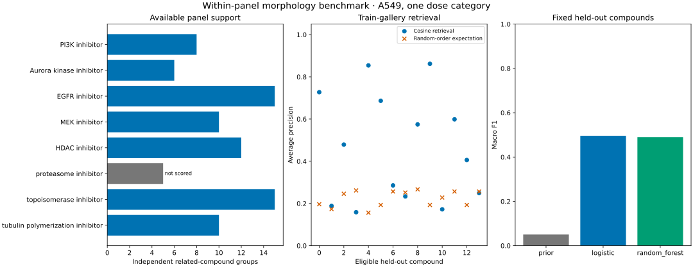
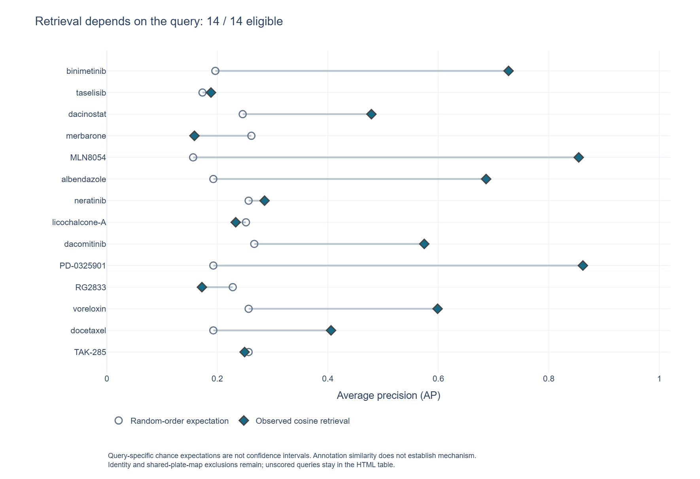

# Morphology transfer benchmark

**Do compounds with the same annotated mechanism produce similar cellular profiles when the query compound is absent from training?**

## Why this project

Cell Painting summarizes cellular appearance after a perturbation, such as a chemical treatment. Similar appearance can suggest a biological relationship between compounds, but it provides only indirect evidence about mechanism. This project examines that distinction using public profiles from A549, a human lung cancer-derived cell line, in the Library of Integrated Network-based Cellular Signatures (LINCS) experiment.

Both retrieval and classification hold out compound identities. Retrieval also excludes references that share a plate map with the query.

[Project background](docs/project-context.md) · [Biology and concepts](docs/biology-and-concepts.md)

## What it does

The repository includes a compact panel derived from raw data: 3,674 wells, including 3,264 dimethyl sulfoxide (DMSO) solvent controls, and 72 fixed shape and intensity measurements. The panel specifies eight mechanism classes chosen before calculating model scores. Seven passed the prespecified rule for the number of distinct identities; the excluded proteasome class remains visible in the audits.

The analysis normalizes each plate using controls only, keeps related compound identities together, and assigns 76 eligible groups to fixed training, validation, and test sets. For retrieval, it ranks reference profiles using cosine similarity, which compares feature-vector directions, and compares the ranks with a random-order expectation.

For classification, it compares a class-frequency baseline with logistic regression and a small random forest. The classifier splits can share plate maps, so their scores do not measure transfer to unseen plate layouts. The analysis does not process images or discover new drug targets.

## Quick start

Use Python 3.12. The bundled analysis runs offline after installing dependencies.

```sh
python -m pip install -r requirements.txt
python -m morphology --output reproduced-results
python scripts/check_reproduction.py reproduced-results
python -m unittest discover -s tests -v
```

The optional `python scripts/fetch_snapshot.py --output /tmp/new-profiles.csv.gz` rebuilds the compact input from content-addressed public profiles. It downloads about 136 raw plate files; normal analysis does not require that download. It refuses to overwrite an existing output.

## Example results

The fixed split has **48 training, 14 validation, and 14 test groups**. All 14 test queries retain a positive training reference after excluding the same compound identity and every shared plate map.

Average precision (AP) scores the ranking of relevant references for each query; the table reports its mean across queries. Macro F1 weights each class equally when averaging class-specific F1 scores, each the harmonic mean of precision and recall.

| Readout | Checked-in result |
| --- | ---: |
| Cosine retrieval mean AP | 0.463 |
| Random-order expected mean average precision | 0.224 |
| Retrieval top-1 matches | 8 / 14 |
| Prior-only classifier macro F1 | 0.050 |
| Logistic classifier macro F1 | 0.496 |
| Random forest macro F1 | 0.490 |



These are small-sample, within-panel results. One changed test prediction moves accuracy by **7.14 percentage points**. The [report](results/report.md) and [metrics](results/metrics.json) give denominators and descriptive uncertainty; the difference between learned models does not establish superiority.

### Inspect the queries behind the mean



The [query explorer](docs/query-explorer.md) pairs each observed AP with the chance expectation for its own retained gallery. Hover reveals positive/total reference counts, annotation, nearest compound and top-1 outcome. Its HTML table preserves ineligible queries as explicitly unscored instead of zero. The builder checks test identities and denominators without changing the saved analysis.

## Practical use and limitations

The output compares compounds with similar profiles against existing annotations. It helps identify relationships to investigate, queries that lack a valid reference, and cases where simple models fail. Similarity does not demonstrate a direct target, a causal mechanism, efficacy, or safety.

The source has fixed well positions, one cell line and one exposure duration. Holding out compound identities does not remove every plate, positional, annotation, or chemistry bias. The source concentration column name conflicts with units in the publication; this analysis preserves the numerical source value and selects its documented dose category. The small number of distinct groups also limits modeling: no neural model is fitted.

## Documentation

[Glossary](docs/glossary.md) · [Assumptions and justifications](docs/assumptions.md) · [Reference audit](docs/reference-audit.json) · [Review record, 20 October 2026](docs/review-2026-10-20.md)

[Maintenance review, 21 October 2026](docs/review-2026-10-21.md) records the Windows checkout fix, source recheck, and interpretation of legacy output labels.

| Guide | What it covers |
| --- | --- |
| [Project context](docs/project-context.md) | Biological question and rationale |
| [Biology and concepts](docs/biology-and-concepts.md) | What profiles, mechanisms and similarities mean |
| [Methods](docs/methods.md) | Selection, normalization, splits, retrieval and models |
| [Data provenance](docs/data-provenance.md) | Sources, exact version, hashes and CC0 reuse |
| [Data dictionary](docs/data-dictionary.md) | Input and output fields |
| [Practical use](docs/practical-use.md) | Contracts, failure behavior and next steps |
| [Literature review](docs/literature-review.md) | Source-to-implementation appraisal |
| [References](docs/references.md) | Primary papers and official resources |
| [Search log](docs/search-log.json) | Exact searches and access limits |

## Development and reuse

The original code is [MIT licensed](LICENSE). Public data are covered separately by the upstream [CC0 license](data/LICENSE_CC0.md). Retain the dataset and article citations when reusing this analysis. Contributions should preserve input hashes, identity grouping, reference exclusions, and honest denominators; see [CONTRIBUTING.md](CONTRIBUTING.md).
